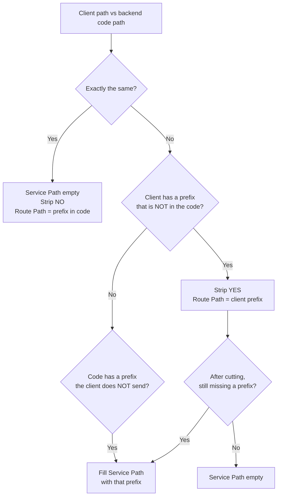

# Kong Cheat Sheet: Route Path, Strip Path, Service Path

> Study notes: how Kong **cuts** and **joins** the path before a request reaches the backend.

---

## 1. The three fields that decide the path

| Field | Where in the dashboard | What it does | Symbol |
|---|---|---|---|
| **Route → Paths** | Route form | **Matches** the request to a backend (always) + **cuts** it (only when Strip is YES) | 🔍 + ✂️ |
| **Route → Strip Path** | Route form | Switch: cut the Route Path or not | 🔘 YES / NO |
| **Service → Path** | Service form | **Joins** (prepends) text in front of the path | ➕ |

```
Route Path   = 🔍 matcher  +  ✂️ cutter (when Strip is YES)
Strip Path   = 🔘 cutter on/off switch
Service Path = ➕ prefix that gets joined in front
```

---

## 2. The formula

```
Backend receives = Service Path  +  ( client URL  −  Route Path , if Strip is YES )
                   └── join ───┘     └──────────────── cut ──────────────────────┘
```

---

## 3. How a request flows through Kong

```
                 Path from the client
   /micro/hb-service/heartbeat/v2/insert_data
                       │
                       ▼
   ┌──────────────────────────────────────────────┐
   │ ① MATCH (Route Path)                          │
   │    "starts with /micro/hb-service?"  ✅        │
   │    → use Service hb-service (mumbai)          │
   └──────────────────────┬───────────────────────┘
                          ▼
   ┌──────────────────────────────────────────────┐
   │ ② CUT? (Strip Path)                           │
   │    YES → remove the Route Path part  ✂️        │
   │    NO  → keep the path as is                  │
   └──────────────────────┬───────────────────────┘
                          ▼
   ┌──────────────────────────────────────────────┐
   │ ③ JOIN (Service Path)                         │
   │    prepend the Service Path  ➕                │
   │    (empty → nothing is added)                 │
   └──────────────────────┬───────────────────────┘
                          ▼
        http://<Service Host>:<Port>  + resulting path
```

---

## 4. Strip YES vs Strip NO

Route Path `/micro/hb-service`, Service Path **empty**:

```
Strip NO  ─────────────────────────────────────────────────────────
  in    : /micro/hb-service/heartbeat/v2/insert_data
  cut   : (nothing)
  out   : /micro/hb-service/heartbeat/v2/insert_data   ← unchanged

Strip YES ─────────────────────────────────────────────────────────
  in    : /micro/hb-service/heartbeat/v2/insert_data
          ✂️────────────────────┘
  out   : /heartbeat/v2/insert_data                        ← cut
```

| | Strip **YES** | Strip **NO** |
|---|---|---|
| Route Path used for matching? | ✅ | ✅ |
| Route Path cut off? | ✅ | ❌ |
| Route Path required? | ✅ | ✅ (still needed to pick the backend) |

> ⚠️ Strip NO **only turns off the cutting**. The Route Path is **still required**, because it tells Kong which backend to use. If it is empty, the Route becomes a *catch-all* and can clash with other Routes.

---

## 5. Cut and join, shown as text pieces

```
Example B: Service Path = /micro/hb-service, Route Path = /hb, Strip YES

  in      [ /hb ][ /heartbeat/v2/insert_data ]
             ✂️ removed
          [ /heartbeat/v2/insert_data ]
             ➕ joined in front
  out     [ /micro/hb-service ][ /heartbeat/v2/insert_data ]
```

In effect, Kong **swaps** `/hb` for `/micro/hb-service`.

---

## 6. Examples

**Backend (Go code):** `/micro/hb-service/heartbeat/v2/insert_data`
**Service Host:Port:** `mumbai-svc:80`
**`KONG`** = `https://kong-gateway-uat.example.com`

### ✅ Correct

| # | Service Path | Route Path | Strip | Client calls | Backend receives |
|---|---|---|---|---|---|
| A ⭐ | *(empty)* | `/micro/hb-service` | **NO** | `KONG/micro/hb-service/heartbeat/v2/insert_data` | `/micro/hb-service/heartbeat/v2/insert_data` |
| B | `/micro/hb-service` | `/hb` | **YES** | `KONG/hb/heartbeat/v2/insert_data` | `/micro/hb-service/heartbeat/v2/insert_data` |
| C | `/micro/hb-service/heartbeat` | `/heartbeat-api` | **YES** | `KONG/heartbeat-api/v2/insert_data` | `/micro/hb-service/heartbeat/v2/insert_data` |
| D | `/micro/hb-service/heartbeat/v2/insert_data` | `/insert-hb` | **YES** | `KONG/insert-hb` | `/micro/hb-service/heartbeat/v2/insert_data` (one endpoint only) |

⭐ = the setup the team uses (`/micro/<name>` pattern + Strip NO)

### ❌ Wrong (common mistakes)

| # | Service Path | Route Path | Strip | Backend receives | Problem |
|---|---|---|---|---|---|
| W1 | *(empty)* | `/micro/hb-service` | **YES** | `/heartbeat/v2/insert_data` | Prefix lost → 404 |
| W2 | `/micro/hb-service` | `/micro/hb-service` | **NO** | `/micro/hb-service/micro/hb-service/...` | Doubled → 404 |
| W3 | `/micro/hb-service` | `/hb` | **NO** | `/micro/hb-service/hb/heartbeat/...` | Stray `/hb` → 404 |
| W4 | `/micro/hb-service` | `/hb/` ← trailing `/` | **YES** | `/micro/hb-serviceheartbeat/...` | Glued together → 404 |

> W4 happens because **Path handling = v1**: Kong joins the pieces as they are, without adding a `/`.
> Rule: **don't end a Route Path with `/`**.

### A backend whose code has NO prefix

Code: `router.Handle("/users/list")`, Route Path `/micro/nairobi`, Service Path empty

| Strip | Client calls | Backend receives | Result |
|---|---|---|---|
| **YES** | `KONG/micro/nairobi/users/list` | `/users/list` | ✅ |
| **NO** | `KONG/micro/nairobi/users/list` | `/micro/nairobi/users/list` | ❌ |

### Empty Route Path (catch-all, e.g. `pvj-ucok`)

Service Path `/pvj-ucok/api/v4`, Route Path **empty**, Methods GET/POST

```
Client : KONG/user/profile
Cut    : (nothing to cut → Strip has no effect)
Join   : /pvj-ucok/api/v4 + /user/profile
Backend: http://pvj-svc:80/pvj-ucok/api/v4/user/profile
```

> A Route with no path acts as a **fallback**: every GET/POST that doesn't match another Route lands here.

---

## 7. Choosing the right setup

Compare **the path the client sends** with **the path in the backend code**:



Text version:

| Situation | Setup |
|---|---|
| Client path **is the same** as the code | Service Path empty + **Strip NO** |
| Client has an **extra** prefix that isn't in the code | **Strip YES** |
| Code has a prefix the client **doesn't send** | Put that prefix in **Service Path** |

---

## 8. Route Path rules

1. **Specific to one backend**: `/micro/hb-service`, not `/micro`.
2. **No trailing `/`**: `/hb`, not `/hb/`.
3. For **Strip NO + empty Service Path**: the Route Path **must match** the start of the path in the backend code.
4. Kong picks the Route with the **longest matching prefix** (the most specific one).

```
Request: /micro/nairobi/users
  Route /micro          ✅ matches
  Route /micro/nairobi  ✅ matches, longer → CHOSEN

Request: /micro/berlin/x   (berlin has no Route yet)
  Route /micro          ✅ matches → goes to the /micro backend by mistake  ⚠️
  (without a /micro Route → Kong returns 404 "no Route matched", which is clearer)
```

---

## 9. The big picture: from client to container

```
Client / Postman
  │  https://kong-gateway-uat.example.com/micro/hb-service/heartbeat/v2/insert_data
  ▼
OpenShift Route  (kong-data-plane)      ← entry into the cluster (≈ "ports:" in docker-compose)
  ▼
Kong Data Plane
  │  ① match Route Path  ② cut (Strip)  ③ join (Service Path)
  ▼
K8s Service  mumbai-svc:80                   ← stable address (DNS .svc.cluster.local)
  ▼
Endpoints → Pod mumbai  :9036                    ← backend container
  ▼
router.Handle("/micro/hb-service/heartbeat/v2/insert_data")  ✅
```

Direct access **without Kong** (no plugins, path not changed):

```
https://heartbeat-uat.example.com/micro/hb-service/heartbeat/v2/insert_data
```

---

## 10. Quick checklist before creating a Service + Route

- [ ] Check the path in the backend code (`router.Handle(...)`)
- [ ] Decide the URL the client will call
- [ ] Service → Host = K8s Service name (e.g. `mumbai-svc`), Port = `80`
- [ ] Service → Path = the **missing** part (empty if nothing is missing)
- [ ] Route → Paths = a **specific** prefix, no trailing `/`
- [ ] Route → Strip = **YES** if the client prefix isn't in the code, **NO** if it is
- [ ] Check: `Service Path + (client − Route Path if YES)` = path in the code? ✅
